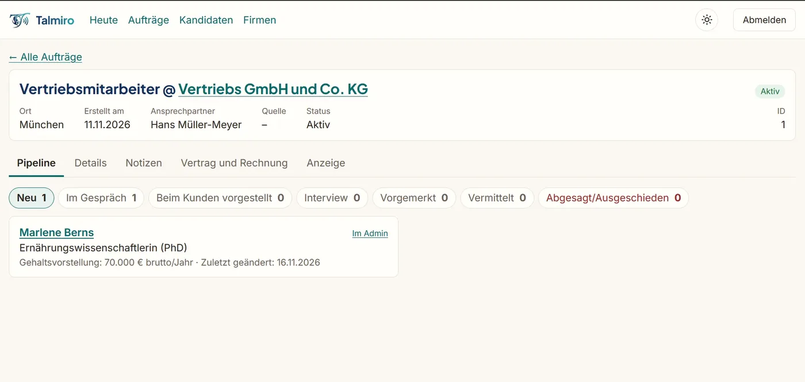
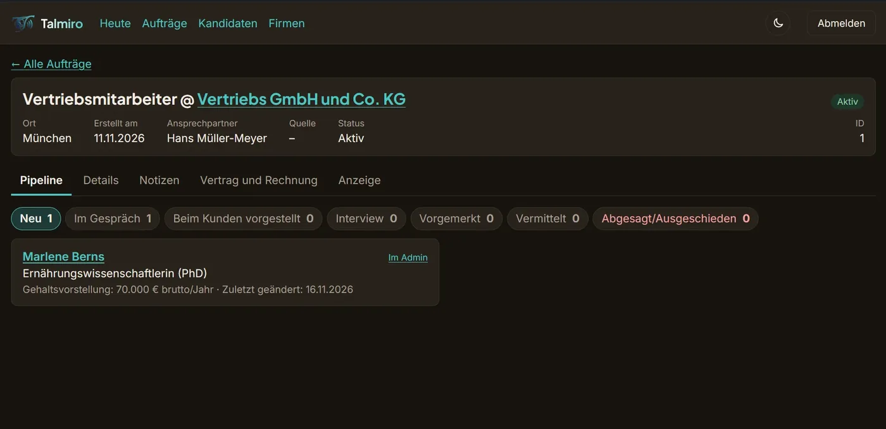
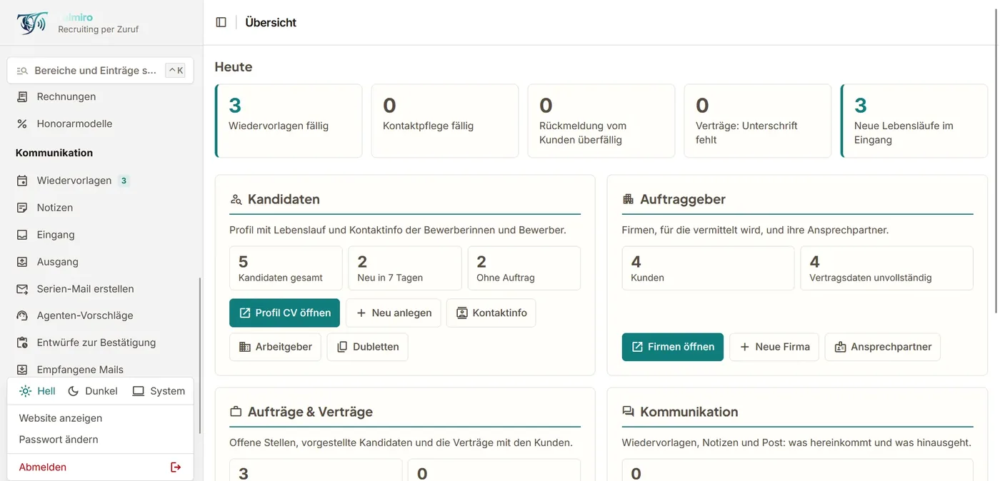
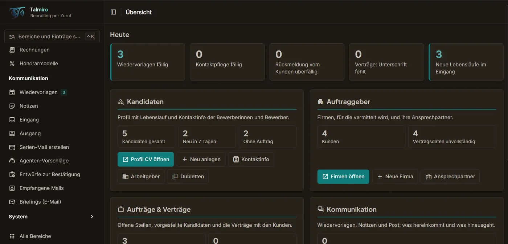
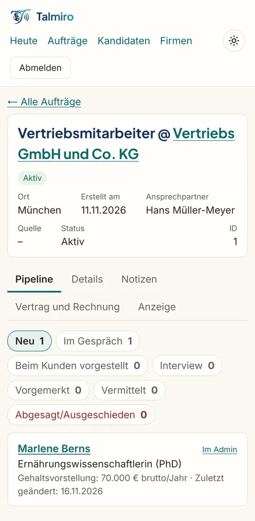
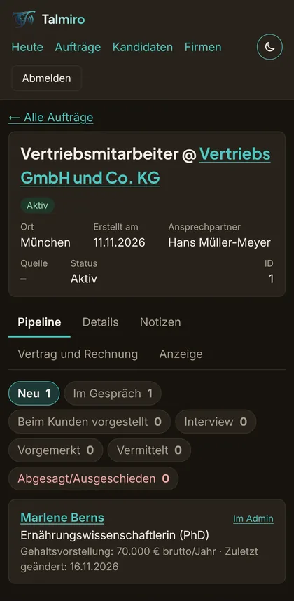
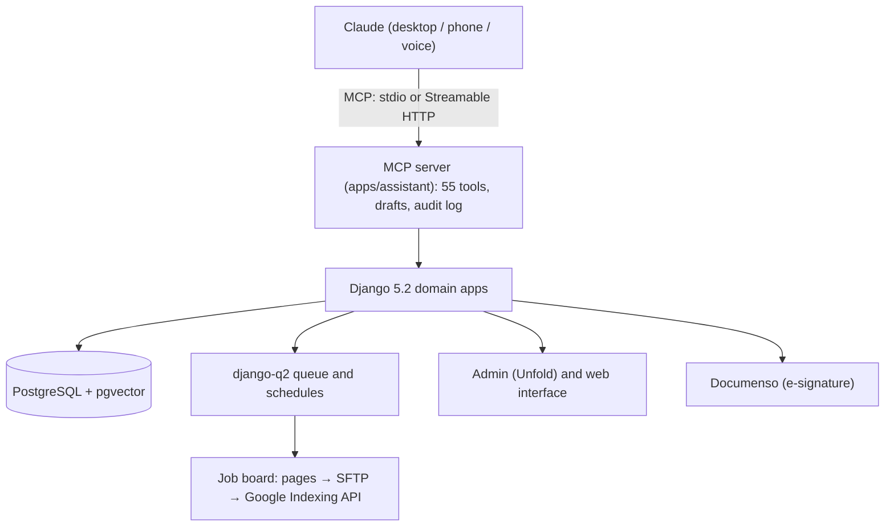

# Talmiro – Recruiting per Zuruf

> **Showcase repository.** Selected documentation, screenshots and code excerpts of a private project, published for application purposes only. The full source code is not part of this repository; the excerpts are not a runnable project. See [LICENSE](LICENSE).

**English** · [Deutsch](#deutsch) · Website: [talmiro.de](https://www.talmiro.de)

## What it is
**Talmiro** is a voice-controlled CRM for independent headhunters. The user works **by voice or text through Claude**; Claude talks to the CRM over an **MCP server** and calls tools such as search a candidate, create a mandate, send a profile or send a contract. The CRM itself enforces the rules – the language model only proposes.

| Web interface (light) | Web interface (dark) |
|---|---|
|  |  |

| Admin (light) | Admin (dark) |
|---|---|
|  |  |

 

*All screenshots show test data only.*

## Features
- **Candidates and CVs** – profiles, CV import (Claude reads the text through tools), changes with preview, protection of manually edited sections.
- **Notes and follow-ups** – by voice, with edit and delete (always with preview).
- **Mandates, including own postings** – mandates with must-have/nice-to-have criteria; **own postings without a client** (for example an ad published on a job platform) with the client functions locked until a company is assigned.
- **Matching** – explainable text matching per criterion (with the place where the term was found), exclusions on the server, no embeddings, never protected characteristics.
- **Pipeline** – candidate ↔ mandate with stages; presenting to a client only through the profile dispatch.
- **E-mail, series mail, rejections** – always draft → preview → "yes" → stop window; series mail only to people with active consent and with a daily limit.
- **Job posting text, LinkedIn text and search string** – anonymous, AGG-conform ad text and boolean search string per mandate.
- **Job board with Google Jobs** – templates → generated pages → SFTP upload (host key pinned) → Google Indexing API.
- **Contracts with e-signature** – Documenso (self-hosted), webhook, audit trail; the hard contract lock sits in the model.
- **Invoices** – fee calculation, draft with preview, numbering, stop window, test mode; everything tax-related is configuration.
- **Briefing** – daily e-mail with what is due.
- **Contact care** – reminders for placed candidates and former clients (read-only, nothing is created automatically).
- **Agents** – small proposal agents that only put suggestions into a list; the user decides.
- **Web interface and admin** – light and dark theme, phone-ready, branded per instance.

## Security concept
- **Preview and "yes":** every action with external effect is prepared as a draft with a preview and a one-time `confirmation_id` (valid 30 minutes) and is released only after an explicit yes. A draft is refused if the data changed in the meantime.
- **Stop window:** after release, sending is delayed; "stop" cancels it.
- **Locks in code, not in the prompt:** no candidate profile to a client without a signed contract; no contract, invoice or client profile for a posting without a client.
- **Protected characteristics** (age, gender, origin, religion and similar) are neither stored nor evaluated; tools reject them.
- **Audit trail without personal data:** each tool call stores the tool name, IDs and field names, not values.
- **Secrets:** only in the `.env`, never in logs, tool results or error texts.

## Architecture

Details: [docs/architektur.md](docs/architektur.md)

## Tech stack
Python · Django 5.2 · PostgreSQL + pgvector · django-q2 · Unfold admin · MCP/FastMCP · Documenso · Docker · Cloudflare Tunnel · pytest · GitHub Actions

## Multi-instance
One instance per customer (own database and settings); the **brand per instance** (title, logo, colors, fonts) comes from a validated `brand.json`. Settings are edited on a settings page with type checks.

## Quality
- More than 4,000 pytest tests (4,090 passed in the last run), parallel in under 3 minutes against PostgreSQL, without network.
- CI with GitHub Actions: migrations on an empty database, tests in parallel, tool budget.
- Budget tests for the size of tool descriptions, schemas and server instructions.

## Code excerpts
Not a runnable project; short, commented excerpts with their origin in the file header ([`code/`](code)):
1. [`01_two_step_confirm.py`](code/01_two_step_confirm.py) – prepare/confirm with a one-time `confirmation_id`
2. [`02_own_posting_lock.py`](code/02_own_posting_lock.py) – own postings and `client_function_block`
3. [`03_brand_loader.py`](code/03_brand_loader.py) – brand loader with validation and fallback
4. [`04_sftp_host_key.py`](code/04_sftp_host_key.py) – SFTP upload with host key check before login
5. [`05_env_register.py`](code/05_env_register.py) – settings register with type checks
6. [`06_tool_budget_test.py`](code/06_tool_budget_test.py) – tool budget as a test

## Status
Working prototype with test data, in a pilot phase. Real personal data is only processed after a data-processing agreement is in place. Next: invoice credit notes and payment reminders, more agents.

## Author
Niko – Python/Django developer with a focus on LLM orchestration. Background: Python/Django, UX, HTML/CSS.

---

## Deutsch
**Talmiro – Recruiting per Zuruf**

> **Schaufenster-Repository.** Ausgewählte Dokumentation, Screenshots und Code-Auszüge eines privaten Projekts, nur zu Bewerbungszwecken veröffentlicht. Der vollständige Quellcode gehört nicht dazu; die Auszüge sind kein lauffähiges Projekt. Siehe [LICENSE](LICENSE).

Website: [talmiro.de](https://www.talmiro.de)

### Worum es geht
**Talmiro** ist ein sprachgesteuertes CRM für selbstständige Headhunter. Bedient wird per **Sprache oder Text über Claude**; Claude greift über einen **MCP-Server** auf das CRM zu (Kandidat suchen, Auftrag anlegen, Profil oder Vertrag senden). Die Regeln hält das CRM selbst – das Sprachmodell schlägt nur vor. Screenshots oben (nur Testdaten).

### Funktionen
- **Kandidaten und CVs** – Profile, CV-Import (Claude liest den Text über Werkzeuge), Änderungen mit Vorschau, Schutz von Hand geänderter Abschnitte.
- **Notizen und Wiedervorlagen** – per Sprache, ändern und löschen immer mit Vorschau.
- **Mandate, auch eigene Ausschreibungen** – Aufträge mit Muss-/Wunschkriterien; **eigene Ausschreibungen ohne Auftraggeber** (z. B. eine auf einer Jobplattform veröffentlichte Anzeige), bei denen Kundenfunktionen gesperrt sind, bis eine Firma zugeordnet ist.
- **Matching** – erklärbare Textsuche je Kriterium (mit Fundstelle), Ausschlüsse auf dem Server, keine Embeddings, nie geschützte Merkmale.
- **Pipeline** – Kandidat ↔ Auftrag mit Stufen; Vorstellen beim Kunden nur über den Profilversand.
- **E-Mail, Serien-Mail, Absagen** – immer Entwurf → Vorschau → „Ja“ → Stopp-Fenster; Serien-Mail nur an Personen mit aktiver Einwilligung und mit Tageslimit.
- **Stellenausschreibung, LinkedIn-Text und Suchstring** – anonymer, AGG-konformer Anzeigentext und Boolean-Suchstring je Auftrag.
- **Stellenbörse mit Google Jobs** – Vorlagen → erzeugte Seiten → SFTP-Upload (Host-Key fest hinterlegt) → Google Indexing API.
- **Verträge mit E-Signatur** – Documenso (selbst betrieben), Webhook, Protokoll; die harte Vertragssperre sitzt im Modell.
- **Rechnungen** – Honorarberechnung, Entwurf mit Vorschau, Nummernvergabe, Stopp-Fenster, Testbetrieb; alles Steuerliche ist Konfiguration.
- **Briefing** – tägliche E-Mail mit dem, was ansteht.
- **Kontaktpflege** – Erinnerungen für Vermittelte und frühere Kunden (nur lesend, nichts wird automatisch angelegt).
- **Agenten** – kleine Vorschlags-Agenten, die nur Vorschläge in eine Liste legen; entschieden wird vom Nutzer.
- **Weboberfläche und Admin** – hell und dunkel, handytauglich, je Instanz in eigener Marke.

### Sicherheitskonzept
- **Vorschau und „Ja“:** Alles mit Außenwirkung wird als Entwurf mit Vorschau und einmaliger `confirmation_id` (30 Minuten gültig) vorbereitet und erst nach ausdrücklichem Ja freigegeben. Hat sich die Datenlage zwischenzeitlich geändert, wird der Entwurf verweigert.
- **Stopp-Fenster:** Nach der Freigabe wird verzögert gesendet; „Stopp“ bricht ab.
- **Sperren im Code, nicht im Prompt:** kein Kandidatenprofil an einen Kunden ohne unterschriebenen Vertrag; kein Vertrag, keine Rechnung und kein Kundenprofil für eine Ausschreibung ohne Auftraggeber.
- **Geschützte Merkmale** (Alter, Geschlecht, Herkunft, Religion u. Ä.) werden weder gespeichert noch bewertet; die Werkzeuge lehnen sie ab.
- **Protokoll ohne Personendaten:** Je Werkzeugaufruf Werkzeugname, IDs und Feldnamen, keine Werte.
- **Geheimnisse:** nur in der `.env`, nie in Protokollen, Werkzeugergebnissen oder Fehlertexten.

### Architektur
Siehe das Diagramm oben und [docs/architektur.md](docs/architektur.md).

### Technik
Python · Django 5.2 · PostgreSQL + pgvector · django-q2 · Unfold-Admin · MCP/FastMCP · Documenso · Docker · Cloudflare Tunnel · pytest · GitHub Actions

### Mandantenfähigkeit
Eine Instanz je Kunde (eigene Datenbank und Einstellungen); die **Marke je Instanz** (Titel, Logo, Farben, Schriften) kommt aus einer geprüften `brand.json`. Einstellungen werden auf einer Einstellungsseite mit Typprüfung geändert.

### Qualität
- Über 4.000 pytest-Tests (4.090 im letzten Lauf), parallel in unter 3 Minuten gegen PostgreSQL, ohne Netz.
- CI mit GitHub Actions: Migrationen auf leerer Datenbank, Tests parallel, Werkzeugbudget.
- Budget-Tests für die Größe von Werkzeugbeschreibungen, Schemas und Server-Anweisung.

### Code-Auszüge
Kein lauffähiges Projekt; kurze, kommentierte Auszüge mit Herkunft im Dateikopf ([`code/`](code)):
1. [`01_two_step_confirm.py`](code/01_two_step_confirm.py) – prepare/confirm mit einmaliger `confirmation_id`
2. [`02_own_posting_lock.py`](code/02_own_posting_lock.py) – eigene Ausschreibungen und `client_function_block`
3. [`03_brand_loader.py`](code/03_brand_loader.py) – Marken-Loader mit Prüfung und Rückfall
4. [`04_sftp_host_key.py`](code/04_sftp_host_key.py) – SFTP-Upload mit Host-Key-Prüfung vor der Anmeldung
5. [`05_env_register.py`](code/05_env_register.py) – Einstellungsregister mit Typprüfung
6. [`06_tool_budget_test.py`](code/06_tool_budget_test.py) – Werkzeugbudget als Test

### Stand
Arbeitsfähiger Prototyp mit Testdaten, in einer Pilotphase. Echte personenbezogene Daten werden erst mit Auftragsverarbeitungsvertrag verarbeitet. Als Nächstes: Gutschriften und Zahlungserinnerungen bei Rechnungen, weitere Agenten.

### Autor
Niko – Python/Django-Entwickler mit Schwerpunkt LLM-Orchestrierung. Hintergrund: Python/Django, UX, HTML/CSS.
