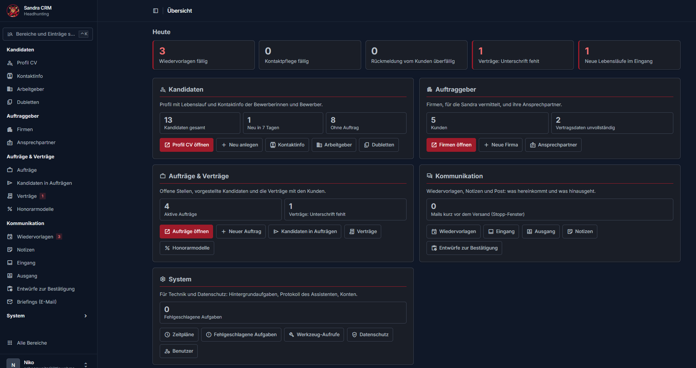

# CRM Agents – voice-controlled recruiting CRM with Claude (MCP)

> **Showcase repository.** Selected documentation and screenshots of a private project, published for application purposes only. The full source code is not part of this repository. See [LICENSE](LICENSE).

**English** · [Deutsch](#deutsch)

## What it is
A Django CRM for executive search. The user works by **voice or text through Claude**; Claude talks to the CRM over an **MCP server** and calls tools such as search, create a mandate, send a candidate profile or send a contract. The CRM itself enforces the rules – the language model only proposes.



## Highlights
- **Two-step actions:** every action with external effect (contract, candidate profile, rejection, e-mail) is first prepared as a draft with a preview, then released with an explicit "yes". Drafts expire after 30 minutes and can be used once.
- **Stop window:** after release, sending is delayed; "stop" cancels it immediately.
- **Hard contract lock:** a candidate profile can only go to a client after the contract is signed (e-signature via Documenso, webhook, audit log). The lock sits in the model, not in the prompt.
- **Protected characteristics:** age, gender, origin, religion and similar data are neither stored nor evaluated; tools reject them.
- **CV processing:** PDF/Word text is read by Claude through tools; assignment checks stop misattributed entries before anything is saved.
- **Audit trail:** every tool call is logged (IDs and field names only, no personal data).
- **Tool budget:** the tool list is context cost for every chat. Descriptions, schemas and server instructions have size limits enforced by tests.

## Architecture
```
Claude (desktop / phone / voice)
        │  MCP (stdio or Streamable HTTP, bearer token)
        ▼
MCP server  (apps/assistant: ~60 tools, drafts, audit log)
        │
        ▼
Django 5.2 · PostgreSQL + pgvector · django-q2 queue
        │                    │
        ▼                    ▼
Admin (Unfold)         Documenso (e-signature, self-hosted)
```
Remote access runs through a Cloudflare tunnel with host and origin checks and rate limiting.

## Tech stack
Python · Django 5.2 LTS · PostgreSQL + pgvector · django-q2 · MCP/FastMCP · Documenso · Docker · pytest (about 1,900 tests against PostgreSQL)

## Code excerpts
Not runnable on their own; they show how the safety concept is built ([`code/assistant`](code/assistant)):
- `models.py` – audit log of tool calls and drafts that expire and can be used once (prepare → confirm)
- `http_app.py` – hardening of the remote MCP endpoint (bearer token, host/origin checks, rate limit)
- `matching.py` – candidate matching against mandate criteria with synonyms, no embeddings
- `server.py` – the server instructions for Claude (rules, two-step flow, stop window)

## Status
Working prototype with test data. Real personal data is only processed after a data-processing agreement is in place.

## Author
Niko – Python/Django developer with a focus on LLM orchestration. Background: Python/Django, UX, HTML/CSS.

---

## Deutsch
**CRM Agenten – sprachgesteuertes Recruiting-CRM mit Claude (MCP)**

> **Schaufenster-Repository.** Ausgewählte Dokumentation und Screenshots eines privaten Projekts, nur zu Bewerbungszwecken veröffentlicht. Der vollständige Quellcode gehört nicht dazu. Siehe [LICENSE](LICENSE).

### Worum es geht
Ein Django-CRM für die Personalvermittlung. Bedient wird per **Sprache oder Text über Claude**; Claude greift über einen **MCP-Server** auf das CRM zu (Suche, Auftrag anlegen, Kandidatenprofil oder Vertrag senden). Die Regeln hält das CRM selbst – das Sprachmodell schlägt nur vor.

### Besonderheiten
- **Zweistufig:** Alles mit Außenwirkung (Vertrag, Profil, Absage, E-Mail) wird erst als Entwurf mit Vorschau vorbereitet und erst nach ausdrücklichem Ja freigegeben (Entwurf 30 Minuten, einmal einlösbar).
- **Stopp-Fenster:** Nach der Freigabe wird verzögert gesendet; „Stopp“ bricht sofort ab.
- **Harte Vertragssperre:** Ein Profil geht erst nach unterschriebenem Vertrag an den Kunden (E-Signatur über Documenso, Webhook, Protokoll). Die Sperre sitzt im Modell, nicht im Prompt.
- **Geschützte Merkmale:** Alter, Geschlecht, Herkunft, Religion u. a. werden weder gespeichert noch bewertet; die Werkzeuge lehnen sie ab.
- **CV-Verarbeitung:** Text aus PDF/Word liest Claude über Werkzeuge; Zuordnungsprüfungen stoppen falsch zugeordnete Einträge vor dem Speichern.
- **Protokoll:** Jeder Werkzeugaufruf wird festgehalten (nur IDs und Feldnamen, keine Personendaten).
- **Werkzeugbudget:** Die Werkzeugliste kostet in jedem Chat Kontext; Größengrenzen für Beschreibungen, Schemas und Server-Anweisung werden per Test erzwungen.

### Technik
Python · Django 5.2 LTS · PostgreSQL + pgvector · django-q2 · MCP/FastMCP · Documenso · Docker · pytest (ca. 1.900 Tests gegen PostgreSQL)

### Code-Auszüge
Nicht für sich lauffähig; sie zeigen den Aufbau des Sicherheitskonzepts ([`code/assistant`](code/assistant)):
- `models.py` – Protokoll der Werkzeugaufrufe und Entwürfe, die ablaufen und nur einmal einlösbar sind (prepare → confirm)
- `http_app.py` – Absicherung des MCP-Fernzugriffs (Bearer-Token, Host-/Origin-Prüfung, Begrenzung)
- `matching.py` – Kandidaten-Matching gegen Auftragskriterien mit Synonymen, ohne Embeddings
- `server.py` – die Server-Anweisung für Claude (Regeln, Zweistufigkeit, Stopp-Fenster)

### Stand
Funktionsfähiger Prototyp mit Testdaten. Echte Personendaten erst nach Abschluss eines Auftragsverarbeitungsvertrags.
