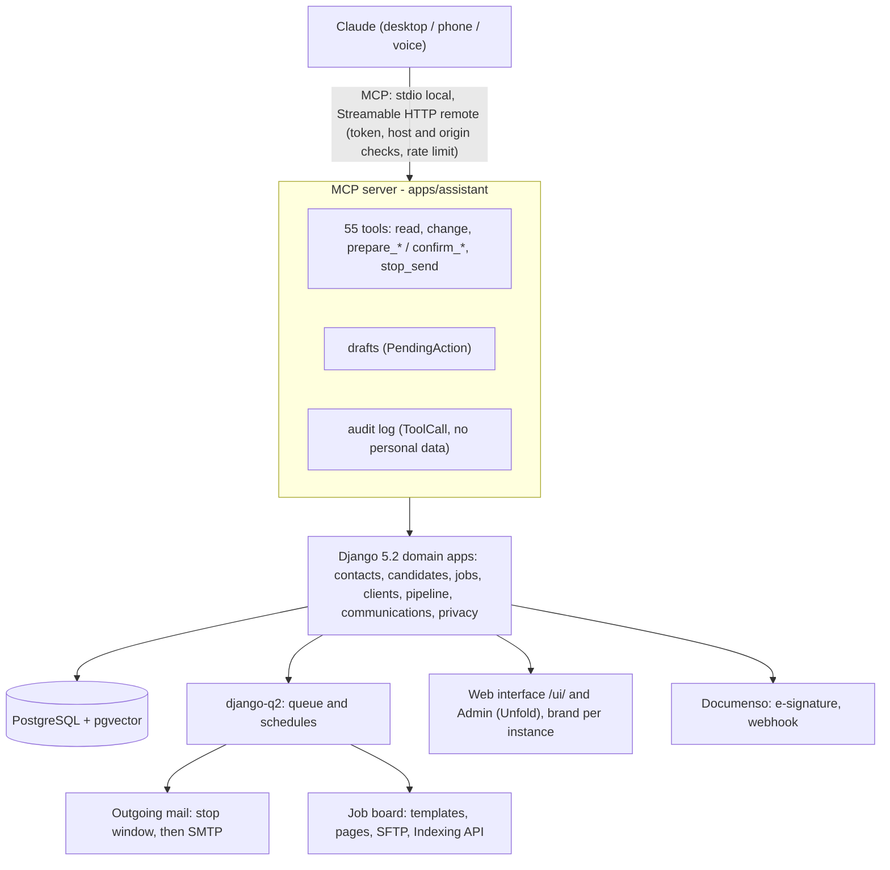
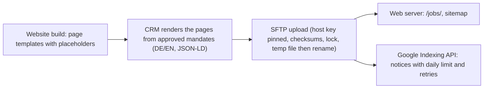

# Architecture / Architektur

**English** · [Deutsch](#deutsch)

## Overview

## Design decisions
- **Claude is the interface, the CRM is the authority.** Rules live in code and the database, never only in a prompt: contract lock, locks for postings without a client, protected-characteristics checks, duplicate checks, expiry of drafts.
- **Two-step writes.** `prepare_*` creates a draft with preview and a one-time `confirmation_id` (30 minutes). `confirm_*` runs only after an explicit yes and refuses if the data changed in between. Most changes share one public `confirm_change`; the kind is stored in the draft and mapped explicitly to an internal function. Drafts with external effect (profile, e-mail, contract, invoice) can only be confirmed with their own `confirm_send_*` tool. See [code/01_two_step_confirm.py](../code/01_two_step_confirm.py).
- **Stop window.** Outgoing contracts, profiles, rejections, e-mails and invoices are delayed; `stop_send` cancels. The SMTP call never runs inside a transaction with a row lock, and the status is saved first, so nothing is sent twice.
- **Hard locks.** A candidate profile can only go to a client once the contract is signed. A posting without a client (`kind=own`) cannot get a contract, an invoice or a client profile until a company is assigned; one method, `client_function_block`, answers for all callers ([code/02_own_posting_lock.py](../code/02_own_posting_lock.py)).
- **No generic dumps.** Tools return explicit fields. Fields that must never reach the model are not part of any tool output; a test asserts this.
- **Audit log without personal data.** Each tool call stores tool name, IDs and field names, not values; personal parameters are redacted.
- **Tool budget.** The tool list and server instructions are context for every chat. Limits for descriptions, schemas and instructions are enforced by tests ([code/06_tool_budget_test.py](../code/06_tool_budget_test.py)). Rules sit in the description of the tool that is called first; only safety rules stay in the always-loaded instructions. For voice mode a second profile offers a short tool list.
- **Swappable providers.** `LLM_PROVIDER` (local Ollama or fake) and `SIGNATURE_PROVIDER` (Documenso or fake). Tests run without network.

## Instances and brands
One instance per customer: own database, own `.env`. The brand of an instance (title, subtitle, logo, favicon, colors for light and dark, fonts) is a folder with a `brand.json`. The loader validates every field and falls back to the default brand with a warning instead of failing ([code/03_brand_loader.py](../code/03_brand_loader.py)). Admin colors, the web interface and generated CSS come from the same brand.

## Settings page
A typed register of `.env` keys (type, range, format, unit, explanation). Inputs are normalized and checked before anything is written; secrets and bank data are masked and never logged; some keys are always locked ([code/05_env_register.py](../code/05_env_register.py)). The page is development-only and not available on customer instances.

## Job board (Google Jobs)

Publishing, removing and re-uploading are deliberate actions of the user; texts can be prepared by Claude. A filled or cancelled mandate takes its page down. The host key is checked before any login ([code/04_sftp_host_key.py](../code/04_sftp_host_key.py)).

## Operations
- **Remote control (off by default).** With a time limit, a monitor runs one entry of a fixed list (`restart`, `migrate`, `pytest`, `setup_schedules`, `backup`) from a file; never free-form commands.
- **Backup.** Daily encrypted backup (restic to a cloud drive via rclone), restore into a new directory and a new test database, status line in the health check. The password file lives outside the project.
- **Diagnostics.** Health check, MCP diagnostic command, schedules check.

## CV processing
Claude reads CV text through tools (`list_new_cvs`, `read_cv`, `create_candidate_from_cv`). Before saving, the server checks that tasks and details sit between the heading of their entry and the next one (two text extraction variants). Unclear cases are reported instead of guessed. Manually edited profile sections are protected when a CV is re-read. For applications that arrive by e-mail, the server only *suggests* the matching open mandate; assigning needs a question and a yes.

## Testing and CI
More than 4,000 pytest tests (4,090 passed in the last run), parallel with pytest-xdist in under 3 minutes (PostgreSQL, one test database per worker, network blocked). GitHub Actions: migrate on an empty database, check for missing migrations, tests, tool budget. A "pytest like CI" script runs the suite without the local `.env` to find hidden dependencies.

---

## Deutsch

### Überblick
Siehe das Diagramm oben. Claude (Desktop, Handy, Sprache) spricht per MCP (stdio lokal, Streamable HTTP aus der Ferne mit Token, Host- und Origin-Prüfung, Begrenzung) mit dem MCP-Server `apps/assistant`. Der enthält 55 Werkzeuge, Entwürfe (`PendingAction`) und das Protokoll (`ToolCall`). Darunter liegen die Django-Apps (Kontakte, Kandidaten, Aufträge, Verträge, Pipeline, Kommunikation, Datenschutz) auf PostgreSQL mit pgvector, django-q2 als Warteschlange und Zeitplan und Documenso für die E-Signatur.

### Entwurfsentscheidungen
- **Claude bedient, das CRM entscheidet.** Regeln stehen in Code und Datenbank, nicht nur im Prompt: Vertragssperre, Sperren für Ausschreibungen ohne Auftraggeber, Prüfung auf geschützte Merkmale, Dublettenprüfung, Ablauf der Entwürfe.
- **Zweistufiges Schreiben.** `prepare_*` erzeugt Entwurf, Vorschau und einmalige `confirmation_id` (30 Minuten); `confirm_*` läuft erst nach ausdrücklichem Ja und verweigert bei zwischenzeitlicher Änderung. Die meisten Änderungen teilen sich ein öffentliches `confirm_change`; die Art steht im Entwurf und wird ausdrücklich einer internen Funktion zugeordnet. Entwürfe mit Außenwirkung (Profil, E-Mail, Vertrag, Rechnung) lassen sich nur mit ihrem eigenen `confirm_send_*` bestätigen. Siehe [code/01_two_step_confirm.py](../code/01_two_step_confirm.py).
- **Stopp-Fenster.** Ausgehende Verträge, Profile, Absagen, Mails und Rechnungen werden verzögert; `stop_send` bricht ab. Der SMTP-Aufruf läuft nie in einer Transaktion mit Zeilensperre, und der Status wird zuerst gesichert: nichts geht doppelt raus.
- **Harte Sperren.** Ein Profil geht erst nach unterschriebenem Vertrag an den Kunden. Eine Ausschreibung ohne Auftraggeber (`kind=own`) bekommt keinen Vertrag, keine Rechnung und kein Kundenprofil, bis eine Firma zugeordnet ist; eine Methode, `client_function_block`, antwortet für alle Aufrufer ([code/02_own_posting_lock.py](../code/02_own_posting_lock.py)).
- **Keine pauschalen Dumps.** Werkzeuge liefern ausdrücklich benannte Felder. Was das Modell nie sehen soll, ist in keiner Ausgabe enthalten; ein Test belegt das.
- **Protokoll ohne Personendaten.** Gespeichert werden Werkzeugname, IDs und Feldnamen, keine Werte; personenbezogene Parameter werden geschwärzt.
- **Werkzeugbudget.** Werkzeugliste und Server-Anweisung kosten in jedem Chat Kontext. Grenzen für Beschreibungen, Schemas und Anweisung erzwingen Tests ([code/06_tool_budget_test.py](../code/06_tool_budget_test.py)). Regeln stehen in der Beschreibung des Werkzeugs, das zuerst gerufen wird; nur Sicherheitsregeln bleiben in der immer geladenen Anweisung. Für den Sprachmodus gibt es ein zweites Profil mit kurzer Werkzeugliste.
- **Austauschbare Anbieter.** `LLM_PROVIDER` (Ollama lokal oder Fake) und `SIGNATURE_PROVIDER` (Documenso oder Fake); Tests laufen ohne Netz.

### Instanzen und Marken
Eine Instanz je Kunde: eigene Datenbank, eigene `.env`. Die Marke einer Instanz (Titel, Untertitel, Logo, Favicon, Farben für hell und dunkel, Schriften) ist ein Ordner mit `brand.json`. Der Loader prüft jedes Feld und fällt bei Fehlern mit Warnung auf die Standardmarke zurück, statt zu scheitern ([code/03_brand_loader.py](../code/03_brand_loader.py)). Admin-Farben, Weboberfläche und erzeugtes CSS stammen aus derselben Marke.

### Einstellungsseite
Ein typisiertes Register der `.env`-Schlüssel (Typ, Bereich, Format, Einheit, Erklärung). Eingaben werden normalisiert und geprüft, bevor etwas geschrieben wird; Geheimnisse und Bankdaten sind maskiert und werden nie protokolliert; manche Schlüssel sind immer gesperrt ([code/05_env_register.py](../code/05_env_register.py)). Die Seite gibt es nur in der Entwicklung, nicht auf Kundeninstanzen.

### Stellenbörse (Google Jobs)
Siehe das Diagramm oben: Die Website liefert Seitenvorlagen mit Platzhaltern, das CRM erzeugt daraus die Seiten freigegebener Aufträge (DE/EN, JSON-LD) und lädt sie per SFTP hoch (Host-Key fest hinterlegt, Prüfsummen, Sperre, Temporärdatei dann Umbenennen); danach meldet es sie an die Google Indexing API (Tageslimit, Wiederholung bei Fehlern). Veröffentlichen, Entfernen und erneutes Hochladen sind bewusste Handlungen des Nutzers; die Texte kann Claude vorbereiten. Ein besetzter oder abgebrochener Auftrag nimmt seine Seite vom Netz. Der Host-Key wird vor jeder Anmeldung geprüft ([code/04_sftp_host_key.py](../code/04_sftp_host_key.py)).

### Betrieb
- **Fernsteuerung (Standard aus).** Mit Zeitlimit führt eine Überwachung einen Eintrag einer festen Liste (`restart`, `migrate`, `pytest`, `setup_schedules`, `backup`) aus einer Datei aus; nie freie Befehle.
- **Backup.** Tägliches verschlüsseltes Backup (restic auf einen Cloud-Speicher über rclone), Wiederherstellung in ein neues Verzeichnis und eine neue Testdatenbank, Statuszeile im Health-Check. Die Passwortdatei liegt außerhalb des Projekts.
- **Diagnose.** Health-Check, MCP-Diagnosebefehl, Prüfung der Zeitpläne.

### CV-Verarbeitung
Claude liest CV-Texte über Werkzeuge. Vor dem Speichern prüft der Server mit zwei Textfassungen, ob Aufgaben und Details zwischen der Überschrift ihres Eintrags und der des nächsten stehen; Unklares wird gemeldet statt geraten. Von Hand geänderte Profilabschnitte bleiben beim erneuten Einlesen erhalten. Bewerbungen per E-Mail bekommen nur einen *Vorschlag*, zu welchem offenen Auftrag sie passen; zugeordnet wird erst nach Rückfrage und Ja.

### Tests und CI
Über 4.000 pytest-Tests (4.090 im letzten Lauf), parallel mit pytest-xdist in unter 3 Minuten (PostgreSQL, eine Test-Datenbank je Worker, Netz gesperrt). GitHub Actions: Migration auf leerer Datenbank, Prüfung auf fehlende Migrationen, Tests, Werkzeugbudget. Ein Skript „pytest wie CI“ führt die Suite ohne lokale `.env` aus und findet versteckte Abhängigkeiten.
